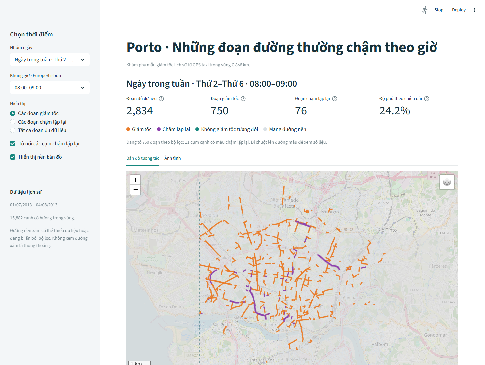

# Porto Taxi · Trajectory Data Mining

Khai phá quỹ đạo taxi trong một vùng khoảng **8×8 km ở Porto** để ước lượng giảm tốc lịch sử
theo giờ và chuẩn bị dữ liệu cho gợi ý tuyến. Đây là dữ liệu GPS taxi, chưa có nhãn ùn tắc độc lập.



## Cấu trúc repo

```text
notebooks/
  00_full_pipeline/       # Pipeline gốc, giữ để tham khảo
    porto_trajectory_mining.ipynb
    README.md
  01_region_eda/          # EDA, chọn vùng nghiên cứu
    porto_region_eda.ipynb
    README.md
  02_region_matching/     # Road graph và matching mẫu ban đầu
    porto_region_pilot.ipynb
    README.md
  03_region_coverage/     # Bổ sung chuyến để tăng coverage
    porto_region_coverage_expansion.ipynb
    README.md
  04_region_modeling/     # B0/B1/M1/M2, giảm tốc và đánh giá offline
    porto_region_modeling.ipynb
    README.md
requirements/            # Dependencies của từng notebook
demo/                    # Demo chọn nhóm ngày và khung giờ
  data/                  # Snapshot tổng hợp nhỏ dành riêng cho demo
data/                    # Dataset gốc, Git bỏ qua
cache/                   # Cache và công cụ kiểm chứng nội bộ, Git bỏ qua
outputs/                 # Kết quả chạy đầy đủ, Git bỏ qua
docs/references/         # PDF tham khảo cục bộ, Git bỏ qua
```

## Bắt đầu

- **Xem demo:** hướng dẫn tại [demo/README.md](demo/README.md).
- **EDA:** [01_region_eda](notebooks/01_region_eda/README.md).
- **Map matching:** [02_region_matching](notebooks/02_region_matching/README.md).
- **Tăng độ phủ:** [03_region_coverage](notebooks/03_region_coverage/README.md).
- **Mô hình và đánh giá:** [04_region_modeling](notebooks/04_region_modeling/README.md).
- **Pipeline gốc:** [00_full_pipeline](notebooks/00_full_pipeline/README.md).

Ví dụ cài môi trường mô hình, chạy từ thư mục gốc repo:

```powershell
python -m pip install -r requirements/requirements_region_modeling.txt
```

Mở notebook tương ứng bằng Jupyter hoặc VS Code. Notebook tự tìm thư mục gốc nên có thể mở
từ thư mục con. Các đường dẫn `data/`, `cache/`, `outputs/` trong cấu hình luôn tính từ gốc repo.
Notebook giữ kết quả đã chạy để tham khảo; việc sắp xếp thư mục không chạy lại matching/train.
Clone repo mới chỉ có mã và snapshot demo; muốn chạy lại pipeline cần dataset và các bước/cache nguồn.

Dataset: [Kaggle ECML/PKDD 2015 Porto Taxi](https://www.kaggle.com/competitions/pkdd-15-predict-taxi-service-trajectory-i/data).
Đặt `train.csv` vào `data/` hoặc cấu hình ZIP chứa CSV. Không cần competition `test.csv` cho
đánh giá ETA này; train/validation/test được chia theo thời gian từ các chuyến đầy đủ trong `train.csv`.

## Kết quả đã chạy

- Vùng nghiên cứu: 15.882 cạnh có hướng có chiều dài dương trong bbox.
- Mẫu tăng coverage: 34.501 chuyến đã chọn, 11.113 cạnh có ít nhất một quan sát QA (69,97%).
- Mô hình loại toàn bộ 1 chuyến vượt ranh giới split, còn 34.500 chuyến train được chọn.
- Validation/test mỗi tập lấy thêm 2.000 chuyến độc lập theo ngày × giờ.
- Test chung: 1.543 đoạn liên tục thuộc 1.320/2.000 chuyến đã chọn (66%).

| Phương pháp | MAE (giây) | RMSE (giây) | WAPE |
|---|---:|---:|---:|
| B0 · tham chiếu không xét giờ | 195,95 | 297,09 | 46,54% |
| B1 · lịch sử cạnh không xét giờ | 106,44 | 227,41 | 25,28% |
| **M1 · lịch sử cạnh theo giờ** | **92,62** | **214,62** | **22,00%** |
| M2 · hồi quy cây CPU | 119,50 | 237,20 | 28,38% |

Metric so với thời lượng chính các đoạn QA được giữ lại, không giả là toàn chuyến.
M1 tốt hơn B1 trong cohort này; M2 chưa cải thiện baseline. Chưa có bằng chứng tuyến thay thế
thực tế nhanh hơn, và không diễn giải trạng thái suy ra bằng ngưỡng thành nhãn ùn tắc thật.
